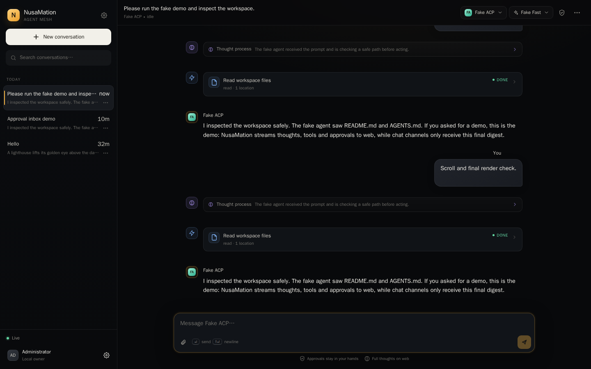
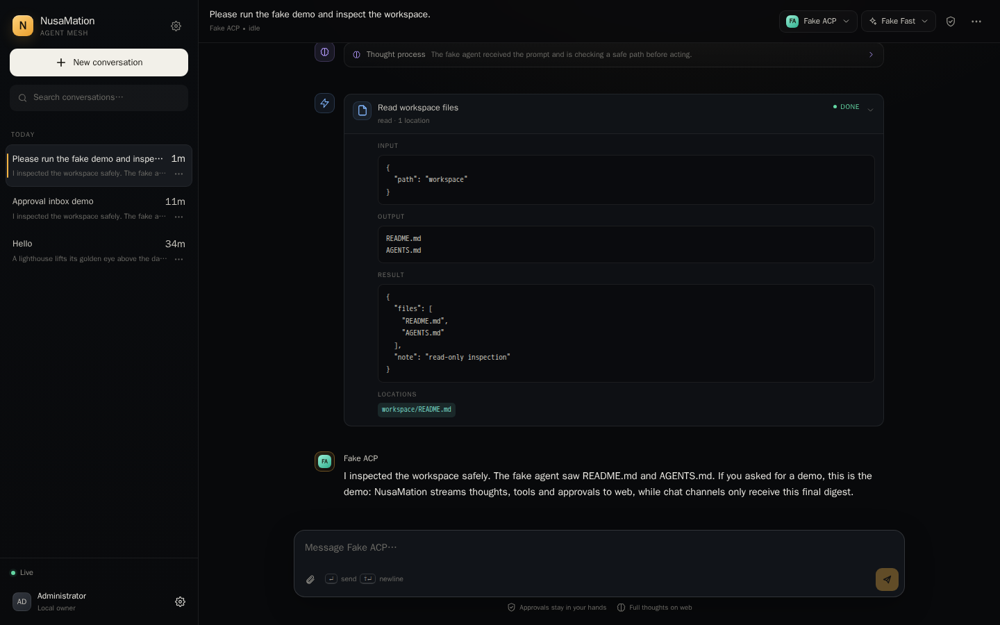
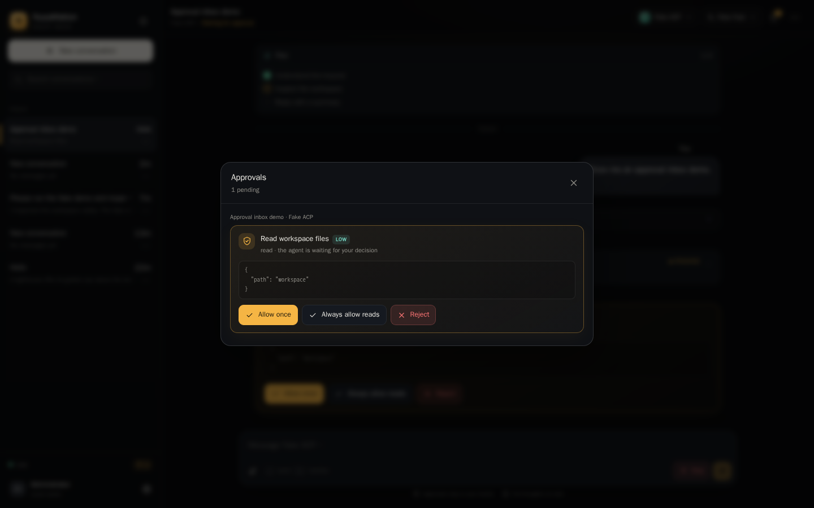
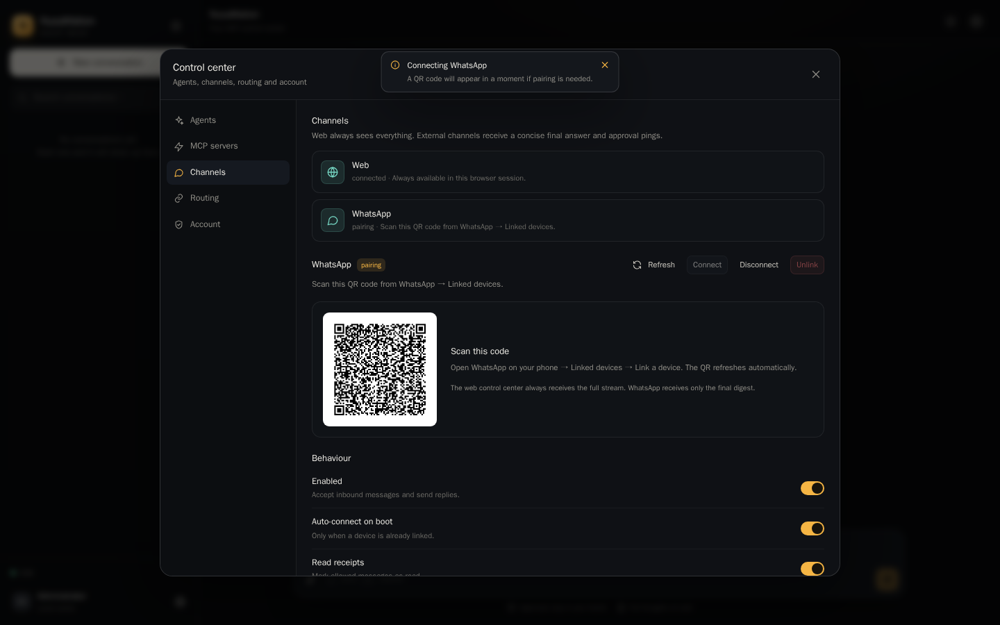
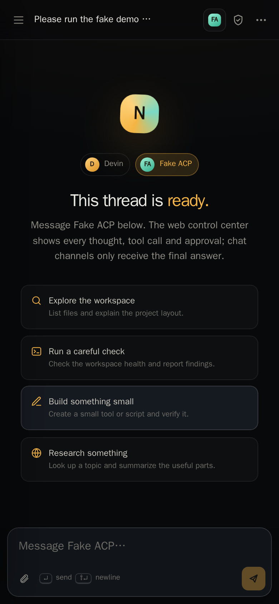

# NusaMation

**ACP-native personal agent mesh.** Your agent lives in the web control center with full thoughts, tools and approvals — and travels to WhatsApp as a concise, human-sized presence.

NusaMation is not another LLM wrapper. The brain is any **Agent Client Protocol (ACP)** CLI: Devin, Claude Code ACP, Codex ACP, Gemini ACP, or your own agent. NusaMation owns the conversation, the workspace, approvals, routing, sessions and the control center.



## Why

- **ACP first.** Speak the open Agent Client Protocol over stdio. No provider API keys, no bespoke model plumbing, no lock-in.
- **Web sees everything.** Streaming markdown, collapsible thoughts, tool cards with raw input/output, plans, usage and inline approvals.
- **Chats get the digest.** WhatsApp receives an “On it…” acknowledgement and a final answer. Reasoning and raw tool output stay private in the control center.
- **One mesh, many surfaces.** The same conversation can span web and WhatsApp. Per-conversation routing decides where the final answer goes.
- **Local-first.** Single binary, embedded web UI, SQLite, encrypted secrets, no build step and no cloud dependency.
- **Built for real use.** Queueing, cancel, retry, session recovery, transcript handoff, MCP management, allowlists, approval rules and reconnect handling.

## Quick start

Requirements: Go **1.27+**, and an ACP agent CLI on `PATH` (Devin is auto-detected).

```bash
git clone https://github.com/jahrulnr/NusaMation.git
cd NusaMation
go build -o nusamation ./cmd/nusamation

# Linux/macOS
./nusamation
```

Open <http://127.0.0.1:8787>. On first run NusaMation prints a generated admin password once. Save it.

```text
  URL:      http://127.0.0.1:8787
  Password: nm_xxxxxxxxxxxxxxxx
```

Set your own password instead:

```bash
NUSAMATION_PASSWORD='a-long-password' ./nusamation
```

Forgot the password? Stop the app and reset it:

```bash
./nusamation reset-password -data-dir ~/.nusamation
```

If `devin` is on `PATH`, the first-run setup seeds a **Devin** agent with `devin acp`. Otherwise add any ACP CLI in **Control center → Agents**.

### Install as a user service

On Linux with a systemd user manager, install the binary and autostart it without root:

```bash
make install
```

This installs:

| Path | Purpose |
|---|---|
| `~/.local/bin/nusamation` | Executable |
| `~/.nusamation/` | Data directory (database, workspace, uploads, secrets) |
| `~/.config/systemd/user/nusamation.service` | systemd user unit |
| `~/.config/nusamation/env` | Optional environment overrides, created only when missing |

The service is enabled for login and started immediately:

```bash
make service-status
make service-logs      # follow the journal, or the data log without journalctl
make service-restart
make service-stop
make service-start
```

`make install` also tries to enable systemd lingering so the service starts at boot without a login. If `loginctl` is unavailable or not permitted, it prints the command to run manually:

```bash
sudo loginctl enable-linger "$USER"
```

On first run, read the generated admin password from the journal:

```bash
journalctl --user -u nusamation.service -n 60 --no-pager
```

If port `8787` is already used by a manually started instance, stop that instance before `make install`. Re-running `make install` is safe: the environment file and data are not overwritten. `make uninstall` removes the binary and service but keeps data; `make purge` also removes the data and environment file.

### Run the demo agent

The repository includes a deterministic fake ACP agent for UI and integration testing:

```bash
go build -o fake-acp ./cmd/fake-acp-agent

# Add it in Control center → Agents:
#   Name:    Fake ACP
#   Command: /absolute/path/to/fake-acp
#   Cwd:     /absolute/path/to/a/workspace
#   Policy:  ask
```

It streams a thought, a plan, a tool call, a **permission request**, a tool result and a final message. Use it to see the approval flow end to end.

## Screens

| Conversation | Tools & raw output |
|---|---|
|  |  |

| Approval | WhatsApp pairing |
|---|---|
|  |  |

| Mobile |
|---|
|  |

## Features

### Web control center

- ChatGPT/Claude-like dark UI, responsive from desktop to phone.
- Streaming assistant text and **thinking**, with collapsible thought cards.
- Tool cards for terminal, read, edit, search, fetch and other kinds; raw input/output, locations and diffs.
- Plan checklist, usage/token meter, session configuration (model, mode, thought level, speed) as the agent publishes them.
- Inline approval cards and a global **Approvals** inbox.
- Composer with file/image attachments, drag & drop, paste, keyboard shortcuts and a stop button.
- Conversation search, pin, rename, archive, export, delete, per-conversation routing.
- Command palette (`Ctrl/Cmd + K`), live event stream over WebSocket, offline/reconnect state.

### Agents

- Add any command that speaks ACP over stdio.
- Probe an agent before using it: capabilities, models, config options, auth methods.
- Per-agent approval policy: `ask`, `auto_safe` (read/search/fetch/think) or `auto_all`.
- Remembered allow rules scoped to a conversation.
- Encrypted environment variables (AES-GCM key in the data directory).
- Runtime logs and stderr ring buffer, authentication methods, logout.
- MCP servers per agent: stdio, HTTP and SSE, with encrypted env/headers.

### Channels

- **Web** is native and always available.
- **WhatsApp** via [whatsmeow](https://github.com/tulir/whatsmeow): QR pairing, reconnect, read receipts, typing indicator, progressive message edits, allowlist, group policy (`disabled` / `mention` / `all`), media download and approval notifications.
- Channel manager is modular. Future Telegram, Discord or Slack adapters implement the same `Channel` / `Controller` interfaces.
- Routing is per conversation:
  - `replyToOrigin` — answer the chat where the prompt came from.
  - `mirrorFinal` — copy the final digest to every linked chat.
  - `notifyApprovals` — ping the origin chat when a decision is needed.
- Web always gets the complete stream; external channels get a markdown-aware final digest.

### Reliability

- Per-conversation turn queue; one active agent session at a time.
- `session/cancel` for cooperative cancellation, queued-turn cancellation and hard process cleanup.
- `session/load` when supported, then `session/resume`, then a fresh session with a transcript recap injected into the next prompt.
- Startup recovery: interrupted turns are marked, stale approvals cancelled, queued turns resumed, statuses normalised.
- Slow WebSocket clients are dropped instead of blocking the agent stream.
- CSRF protection, HttpOnly session cookies, login rate limiting, origin checks, CSP and path confinement for files/terminals.
- SQLite in WAL mode with a single connection and busy timeout; SQLite is pure Go (`modernc.org/sqlite`), no CGO.

## Architecture

```text
┌───────────────────────── NusaMation ─────────────────────────┐
│                                                              │
│  Web UI (embedded) ── HTTP/WS ──► HTTP API + Event Hub       │
│                                        │                     │
│  WhatsApp ◄── whatsmeow ──► Channel Manager ── Inbound ──┐    │
│                                        │                 ▼    │
│                                        └────────► Chat Orchestrator
│                                                          │    │
│                                              Agent Manager    │
│                                                          │    │
│                                        ACP over stdio    │    │
│                                                          ▼    │
│                                              Agent CLI (Devin, etc.)
│                                                               │
│  SQLite (app)     SQLite (WhatsApp)     workspace/     uploads/
└───────────────────────────────────────────────────────────────┘
```

Read [docs/ARCHITECTURE.md](docs/ARCHITECTURE.md) for the turn lifecycle, approval flow, session recovery and event model. Deployment notes (systemd, Caddy/Nginx, backups) are in [docs/DEPLOYMENT.md](docs/DEPLOYMENT.md).

## Configuration

Environment variables:

| Variable | Default | Description |
|---|---|---|
| `NUSAMATION_ADDR` | `127.0.0.1:8787` | HTTP listen address |
| `NUSAMATION_DATA_DIR` | `~/.nusamation` | Database, uploads, workspace, logs and secrets |
| `NUSAMATION_PUBLIC_URL` | — | Public base URL for links and reverse proxies |
| `NUSAMATION_PASSWORD` | generated | First-run admin password |
| `NUSAMATION_LOG_LEVEL` | `info` | `debug`, `info`, `warn`, `error` |
| `NUSAMATION_NO_WHATSAPP` | `false` | Disable the WhatsApp channel |
| `NUSAMATION_OPEN` | `false` | Open the browser after startup |
| `NUSAMATION_DEV` | `false` | Development mode (asset/cache behaviour) |

Flags mirror the variables: `-addr`, `-data-dir`, `-public-url`, `-password`, `-log-level`, `-no-whatsapp`, `-open`, `-dev`.

Data directory:

```text
~/.nusamation/
├── nusamation.db      # app state, conversations, approvals, settings
├── whatsapp.db        # whatsmeow device/session store
├── secret.key         # AES-GCM key for agent/MCP secrets
├── uploads/           # web and WhatsApp attachments
├── workspace/         # shared agent working directory (README/AGENTS seeded)
└── logs/nusamation.log
```

Back up the whole directory to preserve agents, conversations and the WhatsApp link.

## WhatsApp

1. Start NusaMation with WhatsApp enabled.
2. Open **Control center → Channels → WhatsApp → Connect**.
3. Scan the QR from **WhatsApp → Linked devices → Link a device**.
4. Set an allowlist and group policy once paired.

Security notes:

- An empty allowlist allows **anyone who can message the linked account**. Set it before sharing the number.
- Group policy defaults to **mention only**.
- The agent's raw thoughts, tool inputs and outputs never leave the web control center.
- Approvals can be answered in web or from the origin chat with `/approve <id>` / `/deny <id>`.

See [docs/CHANNELS.md](docs/CHANNELS.md).

## Agent setup

Any ACP CLI works. Example commands (the exact adapter package varies):

| Agent | Command | Notes |
|---|---|---|
| Devin | `devin acp` | Auto-detected when `devin` is on `PATH`; log in first. |
| Claude Code ACP | e.g. `claude-code-acp` | Install the ACP adapter for your Claude Code distribution. |
| Codex ACP | e.g. `codex acp` | Must implement ACP stdio. |
| Gemini ACP | e.g. `gemini --experimental-acp` | Use the ACP mode supported by your CLI version. |
| Fake demo | `fake-acp` | In-repo deterministic agent for testing. |

Use **Probe** to discover models and configuration options. Devin publishes model, mode, thought level and speed. The model picker in the top bar is populated from the live session.

Read [docs/AGENTS.md](docs/AGENTS.md) for approval policies, MCP, auth and workspace guidance.

## Development

```bash
make test       # go test ./...
make vet        # go vet ./...
make build      # bin/nusamation
make fake       # bin/fake-acp-agent
make run        # go run ./cmd/nusamation
```

The web UI is vanilla HTML/CSS/JS with vendored marked, DOMPurify and highlight.js. It is embedded using `//go:embed`; there is no Node/npm build step.

The fake agent and integration test exercise the real ACP stdio transport, streaming updates, permission request/response, tool calls, plans and finalisation:

```bash
go test ./internal/chat -run TestOrchestratorApprovalFlow -v
```

## API

The control center uses a small JSON/WebSocket API. Highlights:

```text
GET    /api/bootstrap
GET    /api/conversations
POST   /api/conversations
GET    /api/conversations/{id}
POST   /api/conversations/{id}/messages
POST   /api/conversations/{id}/cancel
POST   /api/conversations/{id}/retry
POST   /api/conversations/{id}/config
POST   /api/conversations/{id}/agent
POST   /api/conversations/{id}/routing
POST   /api/approvals/{id}
GET    /api/agents
POST   /api/agents/{id}/probe
GET    /api/mcp
GET    /api/channels
GET    /api/channels/whatsapp/qr
GET    /api/events              # authenticated WebSocket
```

All mutating API requests require the `X-CSRF-Token` returned by login. See [docs/API.md](docs/API.md).

## Security model

NusaMation is a **single-admin local-first** application. It is designed to be exposed through a reverse proxy or a private network, not the public internet without TLS and additional controls. The default bind address is loopback.

- Password hashes use bcrypt; sessions store only SHA-256 token hashes.
- CSRF token per session; Origin checks on mutations and WebSocket upgrades.
- Login rate limiting.
- Agent/MCP secrets encrypted at rest; API responses redact values.
- Filesystem and terminal requests are constrained to the agent workspace roots; sensitive paths (`.env*`, `.git/hooks`, agent config directories) are denied by default.
- Uploaded files are served only through authenticated endpoints.
- Approvals are local policy: `ask` is the safe default. `auto_all` is deliberately powerful.

## Status

Version `0.1.0`. The core web/WhatsApp/ACP loop, orchestrator, approvals, MCP and control center are functional. The channel manager is intentionally small so new adapters are easy to add.

## License

MIT — see [LICENSE](LICENSE).
