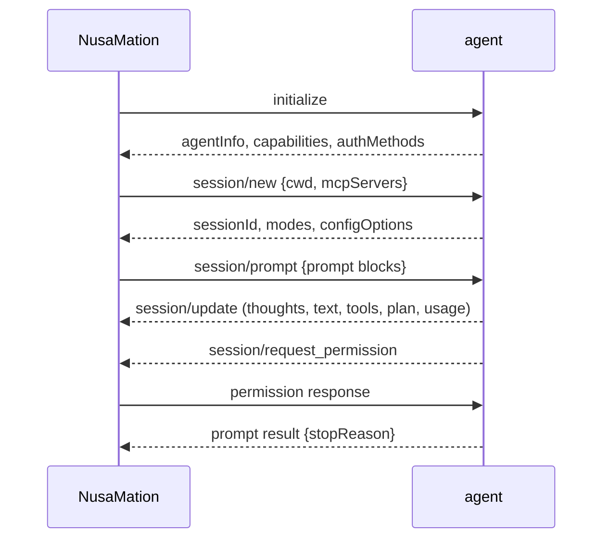

# Agents and ACP

## The model

NusaMation is the **client**; your agent CLI is the **agent**. The client starts the command, speaks ACP over stdio and owns the conversation state around it.



The adapter must implement ACP v1 and use newline-delimited JSON-RPC on stdio. NusaMation advertises filesystem, terminal and permission handling capabilities.

## Add an agent

**Control center → Agents → Add agent**, or the CLI:

```bash
nusamation agent add -name Codex -command codex-acp -cwd /work -policy auto_safe
nusamation agent detect [-add]   # popular ACP CLIs found on PATH
nusamation agent set codex -policy ask -env KEY=val
nusamation agent remove codex
```

On first run (when no enabled agent exists) NusaMation scans `PATH` for the known ACP CLIs — `devin acp`, `claude-agent-acp`/`claude-code-acp`, `codex-acp`, `gemini --acp`, `copilot --acp`, `opencode acp`, `auggie --acp`, `goose acp`, `kimi acp`, `cursor-agent acp`, `kilo acp`, `qwen --acp`, `vibe-acp`, `kiro-cli acp` — and seeds every one it finds.

| Field | Notes |
|---|---|
| Name / slug | Display name and stable identifier |
| Command | Absolute path is most reliable (`which devin`) |
| Arguments | One per line; e.g. `acp` |
| Working directory | Absolute path; must exist and be a directory |
| Approval policy | `ask` (default), `auto_safe`, `auto_all` |
| Default model | Optional; applied when the session exposes a model config |
| Environment | Encrypted secrets passed to the process |
| Enabled | Disabled agents cannot be selected |

Press **Probe** to start a temporary ACP session and capture capabilities, models, config options and auth methods. Probing does not disturb a live conversation.

In a conversation, **Connect agent** prepares the ACP session before the first message. The composer shows the mode separately and groups the model, reasoning, and other advertised settings under the model/options menu. The choices come from the current session; a long list can be searched. On narrow screens the composer keeps the selected model summary and moves all advertised options, including mode, into the **+** menu. The textarea grows within the available viewport.

Permission requests and ACP form/URL input requests appear in a dialog. Login methods advertised by the agent can be started there; terminal-based methods run in a terminal in the dialog, and the agent reconnects after a successful login. A request that the agent never sends over ACP cannot be answered by the client. If a connection or prompt takes a long time, the dialog offers details, wait and stop actions.

### Devin

```text
Command: devin
Args:    acp
Cwd:     /path/to/workspace
```

Devin is auto-seeded when `devin` is on `PATH`, together with any other detected ACP CLI. Log in first with `devin login` (or use the **Authentication** buttons in the agent logs dialog). Devin publishes model, mode, thought level and speed config options; the web model picker uses the live list.

If Devin is slow to start, run **Probe** once to pre-populate the UI, then send the first prompt. Devin's global MCP config may produce noisy stderr; NusaMation keeps it in a bounded ring buffer and never floods the chat.

### Claude Code / Codex / Gemini

The seed catalog covers the common invocations (`claude-agent-acp`, `codex-acp`, `gemini --acp`, …). The Codex CLI is not an ACP server: `codex acp` is an interactive prompt, so Codex is seeded only when `codex-acp` is on `PATH`. An existing agent saved as `codex` with argument `acp` is launched through that adapter, with `CODEX_PATH` set to the configured Codex binary. For other distributions, use the ACP adapter/version appropriate to your installation. The command must:

- speak ACP over stdio;
- accept `initialize` and `session/new`;
- stream `session/update` notifications;
- return a `session/prompt` result with a stop reason.

Exact adapter package names change; probe after adding. A command that only implements a chat REPL is not ACP.

### Fake agent

`cmd/fake-acp-agent` is a deterministic ACP agent for tests and demos. Build it:

```bash
go build -o fake-acp ./cmd/fake-acp-agent
```

Add with command `/absolute/path/to/fake-acp`, any existing workspace, policy `ask`. It streams thought → plan → tool call → permission request → tool result → final text. This is the easiest way to verify the web approval flow and WhatsApp digest without a model account.

## Approval policies

| Policy | Behaviour |
|---|---|
| `ask` | Every `session/request_permission` waits for web/channel approval. |
| `auto_safe` | `read`, `search`, `fetch` and `think` auto-approve; everything else asks. |
| `auto_all` | Every option is auto-approved. Use only in a trusted workspace. |

`allow_always` choices create a conversation-scoped rule for the tool name + kind. Manage/delete rules through `/api/approval-rules`; add agent-scoped rules via the API for a broader trust boundary.

Important: an agent's own permission mode is separate. If an agent is configured to bypass permission requests (for example a “bypass” mode), NusaMation never sees a request to approve. Set the agent's mode to a safe mode if you need app-level approvals.

Changing the mode during a turn is supported. The approval card shows a mode selector for the open conversation. For agents that publish a `mode` config option, the selection is sent with `session/set_config_option`. For agents that only advertise `modes` in the session response, NusaMation exposes them as a synthesized `mode` option and sends `session/set_mode`. The new mode applies to the next permission check. A request that is already pending still needs an answer.

## Sessions and handoff

- NusaMation prefers `session/load` when advertised, then `session/resume`, then a new session.
- When an existing ACP session is missing, a new session is created and the next prompt includes a bounded transcript recap. The web shows a “Session recovered” notice.
- Switching agents keeps the conversation history and creates a handoff recap for the new agent.
- `/new` on a channel starts a fresh conversation and moves the chat link.
- On server restart, interrupted turns are marked and queued turns resume. A failed side-effecting turn is **not** replayed automatically; use Retry.

## Queued input and cancel-and-resend

Sending while a turn runs can steer, queue, or cancel-and-resend. The composer's send menu offers three delivery modes:

- **Steer** (default): when the agent advertises mid-turn prompts or `_session/steering`, the text is injected into the running turn and the agent sees it immediately. On the web, an agent that cannot steer leaves the message in the queue. WhatsApp and other channels use steer, and if the agent cannot steer they wait until the running turn's tools finish, cancel that turn, then send.
- **Add to queue**: the input runs after the current turn finishes.
- **Send after tools**: cancel-and-resend, not steering. Once the running turn's reported tools are all `completed` or `failed` (or right away if it reported none), NusaMation sends `session/cancel`. It then waits for the agent's answer to the cancelled prompt before the queued input starts, so no two prompts overlap. Late updates from the old prompt still belong to the old turn.

Limits: tool states are best-effort reports, so the agent may start a new tool before the cancel lands. A pending approval is not skipped: the cancel waits until the user resolves it. If the agent does not answer within 15 seconds, the conversation shows one notice and the queue keeps waiting. Chat channels receive one message when the turn finishes; thoughts and raw tool output stay on the web.

## MCP servers

**Control center → MCP servers**, shared by all agents:

- **stdio** — command + args + env.
- **http / sse** — URL + headers.

NusaMation filters MCP servers by each agent's advertised ACP MCP capabilities and passes them to `session/new`, `session/load`, and `session/resume`. Secrets are encrypted at rest and never returned by the API. Editing an MCP server invalidates all running agent runtimes, so active turns are interrupted. Older per-agent entries are retained during migration; duplicate names receive an ID suffix and can be reviewed in Settings.

The agent process inherits the NusaMation process environment, with per-agent environment values added on top. Start NusaMation with the environment needed by the configured agents.

## Workspace

The first run seeds `data/workspace/README.md` and `AGENTS.md`. This is the shared working directory for all agents unless a conversation has a different cwd. Client-side ACP filesystem requests check the session roots and sensitive paths. For terminal requests, NusaMation checks the working directory but does not sandbox the command; the agent's own tools and sandbox have their own access rules.

Every start also syncs operational docs into `data/docs/` (embedded in the binary, source in `assets/docs/`): `README.md`, `agents.md`, `whatsapp.md`, `settings.md`, `api.md`, `troubleshooting.md`. They teach agents how to operate NusaMation itself — manage agent CLIs, configure WhatsApp, edit settings, call the API, and debug. The seeded `workspace/AGENTS.md` (appended to existing files when missing) points agents at that directory, the resolved `-data-dir`, the CLI path and the log location. Ops docs live outside the session workspace roots. Client-side `fs/read_text_file` and `fs/write_text_file` stay inside those roots, except when the session mode is Bypass Permissions (`bypass`): that mode already auto-approves every tool call, so the client does not add a second workspace rejection. In other modes a denied read should go through the agent's own file tool or a terminal (`cat`).

The agent's own sandbox controls its direct filesystem and command access; the ACP client-side filesystem checks do not confine commands run in a terminal.

## Troubleshooting

| Symptom | Check |
|---|---|
| Probe fails | Command path, `--version`, ACP mode flag, agent login |
| `agent authentication required` | Use the auth methods in the agent logs dialog |
| Model list empty | Probe or start a session; the agent publishes config options after `session/new` |
| Prompt hangs | Agent may be waiting for approval; check the Approvals inbox |
| Process exits | Agent logs dialog shows stderr and exit state |
| Old session lost | NusaMation falls back to a new session + transcript recap |
| MCP tools missing | Agent capability `mcpCapabilities.http/sse`, server enabled, restart runtime |

Use `NUSAMATION_LOG_LEVEL=debug` for more detail. Agent stderr is deliberately kept out of chat to avoid flooding the UI.
