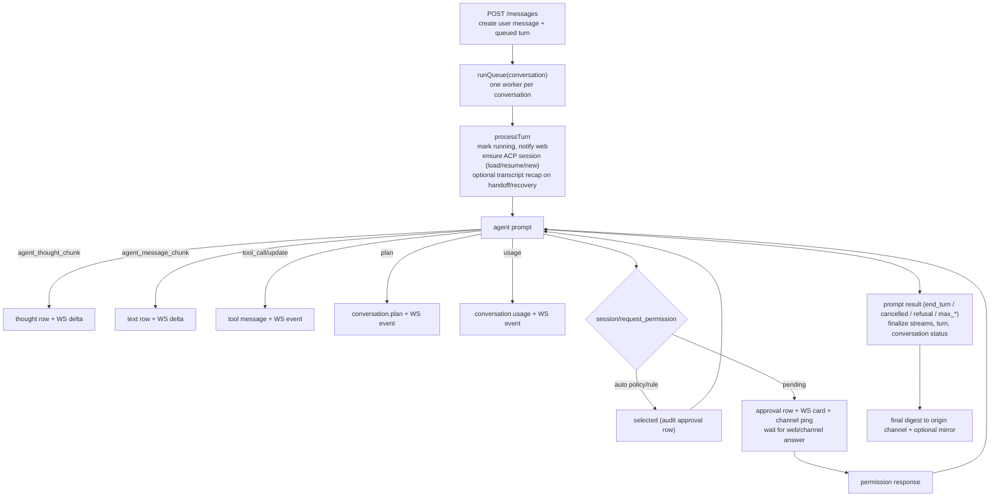

# Architecture

NusaMation is a single Go binary with an embedded browser UI. The agent is an external ACP process; NusaMation owns the session, conversation history, routing and approvals around it.

## Components

### `internal/acp`

A minimal, dependency-free ACP v1 client over newline-delimited JSON-RPC on stdio.

- `Process` handles framing, pending calls, agent→client requests, stderr capture and process-group shutdown.
- `Client` wraps ACP methods: `initialize`, `session/new`, `session/load`, `session/resume`, `session/prompt`, `session/cancel`, `session/set_config_option`, `session/set_mode`, listing/deleting/close.
- Agent requests handled by NusaMation: `fs/read_text_file`, `fs/write_text_file`, `terminal/*` and `session/request_permission`. Elicitation is rejected explicitly.
- Notification handling buffers updates that arrive before `session/new` returns (Devin publishes config and command updates before its session result).

### `internal/agent`

Per-agent process supervision and per-conversation ACP sessions.

- `Manager` lazily starts one ACP process per agent and multiplexes sessions over it.
- `Runtime` owns the process, session map, ACP-session-to-session map and pending notification buffer.
- `Manager.EnableInjectedMCP` registers stdio servers added to every `session/new`, `session/load`, and `session/resume` (`browser_use` and `nusamation_conversation`). Each spec receives the conversation id and returns its own environment, so a server can issue a per-conversation token.
- Session establishment order:
  1. reuse a loaded session;
  2. `session/resume` if supported;
  3. `session/load` if supported (replay suppressed);
  4. `session/new`.
- If load/resume reports an unknown session, NusaMation creates a fresh ACP session and marks it `recovered`; the chat layer prepends a transcript recap.
- A runtime with no traffic for five minutes is reaped (`Manager.ReapIdle`, ticked from `app.Run`): `stopIfIdle` marks `stopping` atomically with the idle check, `Stop` publishes `stopped`/`idle timeout` before closing, and the next `EnsureSession` spawns a fresh runtime and reloads the persisted ACP session id. Running prompts, in-flight session loads, starts in progress and `auto-start` agents are not candidates.
- Agent processes get a sanitized environment and a working directory. The ACP terminal manager accepts a cwd inside any session root and truncates output safely.
- `Probe` launches a temporary process, creates a session, captures capabilities/models/config/auth methods and persists them without disturbing a live conversation.

### `internal/mcp`

The embedded MCP servers an agent spawns. `mcp/stdio` owns JSON-RPC framing and the initialize/ping/tools methods; `mcp/loopback` posts tool calls back to the desktop with the per-conversation bearer token; `mcp/grants` maps tokens to conversations (raw for the legacy `browser_use` file, hashed for `nusamation_conversation`). `mcp/browseruse` exposes the `browser_*` tools and `mcp/conversation` exposes `list`, `projects_list`, `search`, `export`, `read`, `wait`, `send`, `stop`, `spawn`, and `report`. The HTTP bridge handlers stay in `internal/httpapi` because they need the chat service and store; the MCP packages only know the loopback URL and token.

### `internal/store`

SQLite via `modernc.org/sqlite` (pure Go, CGO-free). One connection, WAL, foreign keys, busy timeout.

Tables: `settings`, `sessions`, `agents`, `mcp_servers`, `conversations`, `projects`, `channel_links`, `messages`, `turns`, `approvals`, `approval_rules`, `inbound_messages`, `uploads`.

Messages have monotonic per-conversation `seq`. Turns represent queued/running/waiting/completed prompts. Channel links map external chat IDs to conversations and are unique per `(channel, external_id, thread_id)`. `conversations.metadata_json` carries UI state such as `spawnedBy`, `titleSource` and `defaultConfig`. `messages_fts` is an external-content FTS5 index maintained by triggers (migration 0010) for ranked message search. Conversation-control exports are written as JSONL under `<data>/exports/` with a ten-minute expiry.

### `internal/chat`

The orchestrator. It implements both `agent.Sink` (events coming *from* an agent) and `channels.InboundHandler` (messages coming *from* a channel).

Responsibilities:

- conversation lifecycle, titles, pin/archive, and optional local projects (ordered folders, undo);
- prompt submission and per-conversation turn queue;
- building ACP prompt content from text, images, text files and resource links;
- streaming assistant text and thoughts into DB rows and WebSocket events;
- tool call/update cards;
- plans and usage;
- inline approvals, remembered rules and auto policy;
- external delivery, digest generation and mirroring;
- inbound commands (`/new`, `/agent`, `/model`, `/status`, `/stop`, `/retry`, `/approve`, `/deny`, `/help`);
- startup recovery and session handoff.

### `internal/channels`

A small channel registry.

```go
type Channel interface {
    Name() string
    Label() string
    Start(context.Context) error
    Stop() error
    Status() Status
    Begin(context.Context, Target, string) (Delivery, error)
    Notify(context.Context, Target, string) error
}

type Controller interface {
    Connect(context.Context) error
    Disconnect() error
    Logout(context.Context) error
    QR(context.Context) ([]byte, error)
    Settings(context.Context) (any, error)
    UpdateSettings(context.Context, json.RawMessage) error
}
```

Adapters must not import `chat`; they hand `channels.Inbound` to the registered `InboundHandler`. This keeps the dependency direction one-way and makes new channels cheap.

### `internal/channels/whatsapp`

whatsmeow integration:

- dedicated SQLite store (`whatsapp.db`);
- QR pairing via `GetQRChannel`, server-side QR PNG with `skip2/go-qrcode`;
- inbound text/image/document with size limits, sender/group mention detection and group info name cache;
- allowlist and group policy enforcement before the message reaches the orchestrator;
- composing presence while a turn runs, then a single outbound message when it finishes;
- read receipts, composing presence, logout/unlink and auto-reconnect.

### `internal/realtime`

Authenticated WebSocket hub. Every event has a monotonic ID, type, conversation ID and timestamp. Slow consumers are dropped. Hello event on connect.

### `internal/httpapi`

`net/http` API and embedded SPA. Single-admin auth, CSRF, rate limiting, security headers, upload serving and channel/agent/MCP management. The WebSocket route bypasses the response-status wrapper so HTTP hijacking works. Two loopback bridges accept a bearer token instead of the admin cookie: `/api/browser-use` drives the embedded browser and `/api/conversation-control` serves the `nusamation_conversation` MCP tools.

### `internal/notify`

Desktop notifications. `notify.Wrap(hub, …)` returns an `events.Broadcaster` that forwards every event to the realtime hub and, as a side effect, turns `approval.created` and terminal `turn.completed` states (`completed`, `error`) into OS notifications delivered asynchronously — the agent loop is never blocked by a desktop popup. Backends are per-OS: `notify-send` with urgency on Linux, `osascript` on macOS, and a hidden PowerShell `NotifyIcon` balloon on Windows (`CREATE_NO_WINDOW`). The `notify.enabled` setting and a shutdown `Mute()` suppress popups for intentionally killed agents.

### `internal/update`

Self-update against GitHub releases. A `Manager` polls `releases/latest` shortly after boot and every 6h, compares versions, persists the result, emits `update.status` events and pushes one OS notification per newly seen version. `Apply` re-fetches the release, downloads the platform asset plus `SHA256SUMS`, verifies the checksum, then swaps the binary: Unix renames over the executable and `syscall.Exec`s itself (same PID, so systemd sees no exit); Windows stages a detached PowerShell helper that swaps the file after the process exits and relaunches it. `go run` temp builds refuse self-update. Reconnected web clients see the version change in the `hello` event and reload to fetch matching assets.

### `internal/browser`

Lazy headless Chromium (chromedp/CDP, `-browser-exec`, PATH discovery, or the standard Windows install locations for Chrome/Chromium/Edge) behind the `/browser/*` routes. One shared browser process, one isolated `BrowserContext`+tab per session. Every attached WebSocket gets the same JPEG screencast (share-screen); input is leased to one controller stream — a pane claims it with `takeover`, a controller disconnect hands it to the oldest surviving viewer, and `browser_lock` lets the agent mute pane input until a human preempts. Streams frames over a dedicated WebSocket, forwards CDP input back, and resolves element picks (`document.elementFromPoint` hit test — viewport coordinates, correct at any scroll offset, with same-origin iframe recursion → descriptor extraction incl. viewport + computed style → DOM pin marker (ring + numbered badge) → marked full-viewport screenshot → marker removed → upload) for composer annotations. A per-pin "include screenshot" toggle keeps the image out of the agent prompt. Picks persist as one JSON file each under `<data>/browser-picks/` (in-memory index plus lazy file rehydration) so composer chips survive a server restart; files are removed when their session closes and swept after seven days. Sessions idle-expire without a stream; the browser itself stops when session-free. The package never imports chat/httpapi — the upload save path and the picks directory are injected.

### `web`

Vanilla JS control center. Vendored `marked`, `DOMPurify` and `highlight.js`; no Node build. Renders streaming messages, thoughts, tool cards, plans, approvals, channel settings and the agent/MCP studio. Reconnects the event stream with exponential backoff and resynchronises state on reconnect.

The SPA is native ES modules: `static/app.js` is the entry (binds events, sizes the viewport, boots); feature modules live in `static/components/` — `state.js` is the zero-import leaf holding shared state, `util.js` the DOM/format helpers, and the rest map to UI areas (chat, composer, conversations, settings, ws, events…). Modules may import each other cyclically; that stays safe only because cross-module calls are function declarations used after eval — never call an imported binding at module top level.

## Turn lifecycle



The web receives the full stream regardless of where the turn originated. External channels only receive the final digest (and approval notifications if enabled).

## Session recovery

NusaMation is designed for real ACP processes that crash, get killed or lose a session.

1. Runtime `onExit` ignores a stale exit if a newer client is already alive.
2. Loaded sessions are marked unloaded and `SessionLost` is emitted.
3. On the next prompt, `EnsureSession` retries load/resume/new.
4. If the original ACP session is gone, a fresh session is created and `recovered=true`.
5. The chat layer builds a bounded transcript recap from the last messages and injects it as a text block before the user prompt.
6. Agent switching sets a handoff flag, producing the same recap for the new agent.
7. On app startup, running turns are marked interrupted, pending approvals are cancelled, conversation statuses reset to idle and queued turns are resumed.

Side-effecting prompts are never blindly replayed by the supervisor; a failed turn provides **Retry** in the UI or `/retry` in chat.

## Approval model

- Kinds are mapped to risk: `execute`/`delete`/`switch_mode` high, `edit`/`move` medium, `read`/`search`/`fetch`/`think` low.
- Agent policy:
  - `ask` — every permission request waits;
  - `auto_safe` — low-risk tool kinds auto-approve;
  - `auto_all` — every tool kind auto-approves.
- Conversation-scoped allow rules are created for `allow_always`; agent-scoped rules can be added through the API.
- Auto-approved calls still create an audit approval row and emit an `approval.auto` event.
- If the turn is cancelled or the process exits, pending approvals are cancelled and pending permission requests respond with `cancelled`.

## Event model

| Type | Meaning |
|---|---|
| `conversation.created/updated/deleted` | conversation metadata |
| `message.created/delta/updated` | text/thought/error notices |
| `tool.created/tool.updated` | tool call card |
| `approval.created/resolved/auto/rule` | approval lifecycle |
| `turn.started/status/completed` | turn lifecycle |
| `agent.status/session` | process and ACP session state |
| `channel.status` | channel connection/QR state |
| `config.updated` | live session configuration |
| `conversation.control` | a conversation-control MCP write (caller, tool, outcome) |
| `plan.updated`, `usage.updated` | plan/usage |
| `notice` | transient warning/error/info |
| `update.status` | update check/apply state (stage, progress, error) |
| `hello` | WebSocket handshake (carries `version`) |

## Failure boundaries

- Slow WebSocket clients are dropped; the agent is never blocked by a browser.
- Channel sends use timeouts and never block the prompt loop.
- DB writes are synchronous but throttled for streaming text; final writes always win.
- Upload media is size-limited; download is constrained by MIME and byte budgets.
- The app boots without WhatsApp; a failed channel registration is logged, not fatal.

## Extending

To add Telegram/Discord:

1. Implement `channels.Channel` and, if controllable, `channels.Controller`.
2. Convert inbound payloads into `channels.Inbound` with a stable chat/thread ID.
3. Enforce the adapter's own allowlist/group policy before calling the handler.
4. Return a `Delivery` from `Begin` that edits the acknowledgement if the platform supports edits; otherwise no-op and send on final.
5. Register the channel in `internal/app` and add a settings card in `web/static/components/settings.js` (channel status/panel helpers live in `components/whatsapp.js`).

No changes to the orchestrator are required for a plain text channel.
