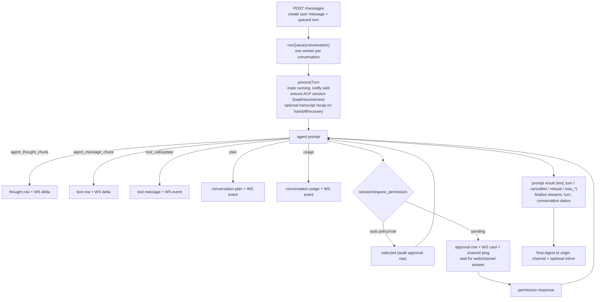

# Architecture

NusaMation is a single Go binary with an embedded browser UI. The agent is an external ACP process; NusaMation owns the session, conversation history, routing and approvals around it.

## Components

### `internal/acp`

A minimal, dependency-free ACP v1 client over newline-delimited JSON-RPC on stdio.

- `Process` handles framing, pending calls, agent→client requests, stderr capture and process-group shutdown.
- `Client` wraps ACP methods: `initialize`, `session/new`, `session/load`, `session/resume`, `session/prompt`, `session/cancel`, `session/set_config_option`, `session/set_mode`, listing/deleting/close.
- Agent requests handled by NusaMation: `fs/read_text_file`, `fs/write_text_file`, `terminal/*` and `session/request_permission`. Elicitation is rejected explicitly.
- Notification handling buffers updates that arrive before `session/new` returns (Devin publishes config and command updates before its session result).

### `internal/agent`

Per-agent process supervision and per-conversation ACP sessions.

- `Manager` lazily starts one ACP process per agent and multiplexes sessions over it.
- `Runtime` owns the process, session map, ACP-session-to-session map and pending notification buffer.
- Session establishment order:
  1. reuse a loaded session;
  2. `session/load` if supported (replay suppressed);
  3. `session/resume` if supported;
  4. `session/new`.
- If load/resume reports an unknown session, NusaMation creates a fresh ACP session and marks it `recovered`; the chat layer prepends a transcript recap.
- Agent processes get a sanitized environment and a working directory. The ACP terminal manager confines cwd to session roots and truncates output safely.
- `Probe` launches a temporary process, creates a session, captures capabilities/models/config/auth methods and persists them without disturbing a live conversation.

### `internal/store`

SQLite via `modernc.org/sqlite` (pure Go, CGO-free). One connection, WAL, foreign keys, busy timeout.

Tables: `settings`, `sessions`, `agents`, `mcp_servers`, `conversations`, `channel_links`, `messages`, `turns`, `approvals`, `approval_rules`, `inbound_messages`, `uploads`.

Messages have monotonic per-conversation `seq`. Turns represent queued/running/waiting/completed prompts. Channel links map external chat IDs to conversations and are unique per `(channel, external_id, thread_id)`.

### `internal/chat`

The orchestrator. It implements both `agent.Sink` (events coming *from* an agent) and `channels.InboundHandler` (messages coming *from* a channel).

Responsibilities:

- conversation lifecycle, titles, pin/archive;
- prompt submission and per-conversation turn queue;
- building ACP prompt content from text, images, text files and resource links;
- streaming assistant text and thoughts into DB rows and WebSocket events;
- tool call/update cards;
- plans and usage;
- inline approvals, remembered rules and auto policy;
- external delivery, digest generation and mirroring;
- inbound commands (`/new`, `/agent`, `/model`, `/status`, `/stop`, `/retry`, `/approve`, `/deny`, `/help`);
- startup recovery and session handoff.

### `internal/channels`

A small channel registry.

```go
type Channel interface {
    Name() string
    Label() string
    Start(context.Context) error
    Stop() error
    Status() Status
    Begin(context.Context, Target, string) (Delivery, error)
    Notify(context.Context, Target, string) error
}

type Controller interface {
    Connect(context.Context) error
    Disconnect() error
    Logout(context.Context) error
    QR(context.Context) ([]byte, error)
    Settings(context.Context) (any, error)
    UpdateSettings(context.Context, json.RawMessage) error
}
```

Adapters must not import `chat`; they hand `channels.Inbound` to the registered `InboundHandler`. This keeps the dependency direction one-way and makes new channels cheap.

### `internal/channels/whatsapp`

whatsmeow integration:

- dedicated SQLite store (`whatsapp.db`);
- QR pairing via `GetQRChannel`, server-side QR PNG with `skip2/go-qrcode`;
- inbound text/image/document with size limits, sender/group mention detection and group info name cache;
- allowlist and group policy enforcement before the message reaches the orchestrator;
- composing presence while a turn runs, then a single outbound message when it finishes;
- read receipts, composing presence, logout/unlink and auto-reconnect.

### `internal/realtime`

Authenticated WebSocket hub. Every event has a monotonic ID, type, conversation ID and timestamp. Slow consumers are dropped. Hello event on connect.

### `internal/httpapi`

`net/http` API and embedded SPA. Single-admin auth, CSRF, rate limiting, security headers, upload serving and channel/agent/MCP management. The WebSocket route bypasses the response-status wrapper so HTTP hijacking works.

### `web`

Vanilla JS control center. Vendored `marked`, `DOMPurify` and `highlight.js`; no Node build. Renders streaming messages, thoughts, tool cards, plans, approvals, channel settings and the agent/MCP studio. Reconnects the event stream with exponential backoff and resynchronises state on reconnect.

The SPA is native ES modules: `static/app.js` is the entry (binds events, sizes the viewport, boots); feature modules live in `static/components/` — `state.js` is the zero-import leaf holding shared state, `util.js` the DOM/format helpers, and the rest map to UI areas (chat, composer, conversations, settings, ws, events…). Modules may import each other cyclically; that stays safe only because cross-module calls are function declarations used after eval — never call an imported binding at module top level.

## Turn lifecycle



The web receives the full stream regardless of where the turn originated. External channels only receive the final digest (and approval notifications if enabled).

## Session recovery

NusaMation is designed for real ACP processes that crash, get killed or lose a session.

1. Runtime `onExit` ignores a stale exit if a newer client is already alive.
2. Loaded sessions are marked unloaded and `SessionLost` is emitted.
3. On the next prompt, `EnsureSession` retries load/resume/new.
4. If the original ACP session is gone, a fresh session is created and `recovered=true`.
5. The chat layer builds a bounded transcript recap from the last messages and injects it as a text block before the user prompt.
6. Agent switching sets a handoff flag, producing the same recap for the new agent.
7. On app startup, running turns are marked interrupted, pending approvals are cancelled, conversation statuses reset to idle and queued turns are resumed.

Side-effecting prompts are never blindly replayed by the supervisor; a failed turn provides **Retry** in the UI or `/retry` in chat.

## Approval model

- Kinds are mapped to risk: `execute`/`delete`/`switch_mode` high, `edit`/`move` medium, `read`/`search`/`fetch`/`think` low.
- Agent policy:
  - `ask` — every permission request waits;
  - `auto_safe` — low-risk tool kinds auto-approve;
  - `auto_all` — every tool kind auto-approves.
- Conversation-scoped allow rules are created for `allow_always`; agent-scoped rules can be added through the API.
- Auto-approved calls still create an audit approval row and emit an `approval.auto` event.
- If the turn is cancelled or the process exits, pending approvals are cancelled and pending permission requests respond with `cancelled`.

## Event model

| Type | Meaning |
|---|---|
| `conversation.created/updated/deleted` | conversation metadata |
| `message.created/delta/updated` | text/thought/error notices |
| `tool.created/tool.updated` | tool call card |
| `approval.created/resolved/auto/rule` | approval lifecycle |
| `turn.started/status/completed` | turn lifecycle |
| `agent.status/session` | process and ACP session state |
| `channel.status` | channel connection/QR state |
| `config.updated` | live session configuration |
| `plan.updated`, `usage.updated` | plan/usage |
| `notice` | transient warning/error/info |
| `hello` | WebSocket handshake |

## Failure boundaries

- Slow WebSocket clients are dropped; the agent is never blocked by a browser.
- Channel sends use timeouts and never block the prompt loop.
- DB writes are synchronous but throttled for streaming text; final writes always win.
- Upload media is size-limited; download is constrained by MIME and byte budgets.
- The app boots without WhatsApp; a failed channel registration is logged, not fatal.

## Extending

To add Telegram/Discord:

1. Implement `channels.Channel` and, if controllable, `channels.Controller`.
2. Convert inbound payloads into `channels.Inbound` with a stable chat/thread ID.
3. Enforce the adapter's own allowlist/group policy before calling the handler.
4. Return a `Delivery` from `Begin` that edits the acknowledgement if the platform supports edits; otherwise no-op and send on final.
5. Register the channel in `internal/app` and add a settings card in `web/static/components/settings.js` (channel status/panel helpers live in `components/whatsapp.js`).

No changes to the orchestrator are required for a plain text channel.
